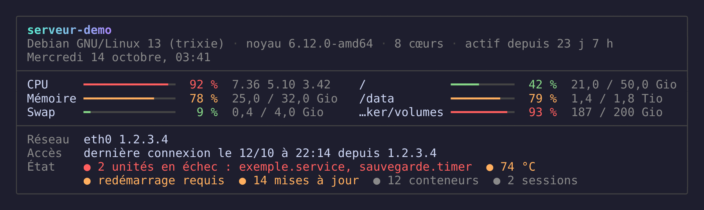

# Dotfiles


Configuration personnelle pour le shell, l'éditeur et le terminal.
Pensée pour être appliquée rapidement sur une nouvelle machine via `install.sh`,
sur Debian/Ubuntu, RHEL-like (RHEL, Rocky, Alma, Fedora) et Windows via WSL.

👉 Pour l'utilisation au quotidien (alias, raccourcis, prompt...), voir [USAGE.md](USAGE.md).
👉 Pour un pense-bête condensé (raccourcis WezTerm/tmux, alias...), voir [TIPS.md](TIPS.md).



*Message d'accueil ([.shell/motd](.shell/motd)), ici avec `--demo`.*

## Structure

- [.zshrc](.zshrc) — config Zsh, plugins gérés par [Sheldon](https://github.com/rossmacarthur/sheldon)
- [.bashrc](.bashrc) — équivalent bash, pour les serveurs sans zsh (`./install.sh --bash`)
- [.vimrc](.vimrc) — config Vim (éditeur par défaut du shell ; le développement se fait dans VSCode)
- [.tmux.conf](.tmux.conf) — config tmux (préfixe Ctrl+a, souris, mode vi)
- [.shell/](.shell/) — alias, fonctions et scripts shell perso
  - `env` — environnement commun à zsh et bash (PATH, éditeur, nvm à la demande)
  - `alias` — alias et fonctions, communs à zsh et bash (eza, docker, git, serveurs...)
  - `alias_srv.example` — modèle pour tes alias locaux en plus (non versionnés)
  - `motd` — message d'accueil du shell (charge, mémoire, disques, réseau, dernière connexion, état ; bash seul, sans droit root)
  - `add_srv.sh` — ajoute un serveur dans `~/.ssh/config` (alias `addsrv`)
- [sheldon/](sheldon/) — gestionnaire de plugins Zsh (voir [sheldon/README.md](sheldon/README.md))
- [starship.toml](starship.toml) — prompt Starship orienté DevOps/sécu (git, Docker, k8s, AWS, Terraform, Python venv)
- [wezterm/](wezterm/) — config WezTerm modulaire + plugins (voir [wezterm/README.md](wezterm/README.md))
- [git/aliases.gitconfig](git/aliases.gitconfig) — alias git complémentaires, inclus depuis `~/.gitconfig`
- [install.sh](install.sh) — bootstrap : crée les liens symboliques, installe les outils, contrôle l'installation (`--check`)
- [tests/check-aliases.sh](tests/check-aliases.sh) — vérifie que chaque alias lance une commande qui existe
- [tests/check-leaks.sh](tests/check-leaks.sh) — vérifie qu'aucune information personnelle n'entre dans ce dépôt public

## Installation sur une nouvelle machine

```bash
git clone https://github.com/Kaguts/dotefiles.git ~/dotfiles
cd ~/dotfiles

# Liens symboliques uniquement
./install.sh

# Liens symboliques + outils du groupe "base" (shell, prompt, eza, bat, fzf...)
./install.sh --tools

# Avec des groupes en plus : extra, docker, k8s, iac, secu (ou "all")
./install.sh --with docker,iac

# Contrôler l'installation sans rien modifier
./install.sh --check
```

### Groupes d'outils

`--tools` n'installe que le groupe `base`. Le reste se demande avec
`--with`, pour n'avoir sur chaque machine que ce qui y sert :

| Groupe | Contenu |
|---|---|
| `base` | `zsh`, `starship`, `sheldon`, `eza`, `bat`, `fd`, `ripgrep`, `fzf`, `zoxide`, `delta`, `dysk`, `btop`, `tmux`, `vim`, `httpie` |
| `extra` | `lazygit`, `gping`, `glow` |
| `docker` | `lazydocker`, `dive` |
| `k8s` | `k9s` |
| `iac` | `ansible`, `tenv` |
| `secu` | `nmap`, `lynis`, `gobuster`, `rustscan`, `nuclei`, SecLists |

Les groupes choisis sont mémorisés dans `~/.config/dotfiles/env` : un
`./install.sh --tools` ultérieur les reprend. `--sysadmin` équivaut à
`--update --with extra,docker,k8s,iac`.

### Serveur sans droits root, binaires dans un dossier choisi

```bash
./install.sh --no-root --bash --tools --bin-dir /data/outils/bin
```

- `--no-root` : n'essaie pas `sudo` (pas de demande de mot de passe), aucun
  paquet système ; tout ce qui existe en binaire est téléchargé.
- `--bin-dir DOSSIER` : les binaires vont dans ce dossier au lieu de
  `~/.local/bin`. Le choix est mémorisé dans `~/.config/dotfiles/env` et le
  dossier est ajouté au `PATH` par `~/.shell/env`, en zsh comme en bash.
- `--bash` : met en place `~/.bashrc` (l'ancien est sauvegardé), pour les
  serveurs où zsh n'est pas installé. Même prompt Starship, mêmes alias,
  `cd` avec zoxide, Ctrl-R avec fzf. Un shell non interactif (`scp`, `rsync`,
  Ansible) ne charge rien.

Restent à demander à un admin, faute de binaire autonome : `zsh`, `tmux`,
`btop`, `vim`.

### Rester à jour

À la première ouverture de shell de la journée, la config compare le dépôt
local à sa version en ligne (une seule interrogation par jour, 4 secondes au
plus, rien n'est téléchargé). Si une nouvelle version existe, une ligne le
signale :

```
dotfiles : une nouvelle version est en ligne. Lance 'dotup' pour l'installer.
```

`dotup` (ou `./install.sh --upgrade`) fait alors, dans l'ordre :

1. `git pull --ff-only` dans le dépôt (abandon sans rien modifier en cas de
   conflit avec des modifications locales) ;
2. refait les liens symboliques avec la nouvelle version ;
3. remplace les binaires déjà installés dont la version a changé dans
   `tools.lock`, et met à jour les plugins Sheldon.

Les paquets système ne sont pas touchés (c'est le rôle d'`apt`/`dnf`), donc
aucun mot de passe `sudo` n'est demandé. Les réglages mémorisés (dossier des
binaires, groupes) sont repris tels quels.

Pour désactiver le contrôle quotidien : `touch ~/.config/dotfiles/no-update-check`.

### Contrôler l'installation

`./install.sh --check` ne modifie rien et signale : version en retard sur le
dépôt en ligne, lien symbolique cassé,
`include.path` git qui pointe dans le vide, dossier des binaires hors du
`PATH`, plugins Sheldon non installés, alias sans cible, outil manquant dans
un groupe demandé. Code retour 1 s'il reste un point à corriger.

### Mettre à jour les liens (dépôt déplacé/renommé)

Si tu déplaces ou renommes le dossier du repo, les liens symboliques et
l'`include.path` git pointent encore vers l'ancien emplacement. Relance
simplement :

```bash
./install.sh --update
```

Cela recrée tous les liens symboliques vers le nouvel emplacement et nettoie
les anciennes références `include.path` obsolètes dans `~/.gitconfig`.

Le script sauvegarde les fichiers existants dans `~/.dotfiles_backup/<date>/`
avant de créer les liens.

### Compatibilité distro / droits root

`--tools` détecte automatiquement l'environnement :

- **Debian/Ubuntu** (`apt`) : installation via les paquets officiels. Les
  paquets absents d'une version donnée (`eza`, `lazygit`, `gping`, `glow` sur
  Debian 12 ou Ubuntu 22.04) sont signalés puis installés en binaire.
- **RHEL-like** (RHEL, Rocky, Alma, CentOS, Fedora — `dnf`/`yum`) : active EPEL
  (via le RPM du projet Fedora sur RHEL) et CRB, puis installe
  ce qui est packagé (`ripgrep`, `fzf`, `bat`, `fd-find`, `tmux`, `btop`,
  `httpie`, `vim-enhanced`, `xclip`...).
  Les outils non packagés sur RHEL-like (`eza`, `zoxide`, `lazygit`,
  `gobuster`, `gping`, `delta`, `glow`, `lazydocker`, `k9s`, `dive`, `tenv`,
  `rustscan`) sont installés en binaire dans `~/.local/bin` (voir ci-dessous).
- **Sans droits root/sudo** : l'étape des paquets système est ignorée (avec
  la liste à transmettre à un admin), mais tous les outils installables en
  binaire (Starship, Sheldon, `fzf`, `bat`, `fd`, `ripgrep` et la liste
  ci-dessus) sont quand même installés, dans `~/.local/bin` ou dans le
  dossier donné par `--bin-dir`, car ils ne nécessitent pas de droits root.

- **Architecture** : x86_64 et arm64.

Dans tous les cas, un récapitulatif final liste les outils encore absents, et
aucune étape en échec n'arrête le script. `zsh` est installé mais le shell de
connexion n'est pas changé d'office : le script rappelle la commande `chsh`.

### Windows (WSL)

Tout se passe dans la distribution WSL (Debian, Ubuntu, Rocky...) : clone le
dépôt dans le système de fichiers Linux (`~/dotfiles`, pas `/mnt/c`) et lance
`install.sh` comme sur une machine Linux.

WezTerm tourne côté Windows et ne peut pas suivre un lien symbolique créé dans
WSL. Pour y copier la config :

```bash
./install.sh --wezterm-windows
```

La config arrive dans `%USERPROFILE%\.config\wezterm` (l'ancienne est renommée
en `.bak-<date>`). C'est une copie : relance la commande après chaque
modification. WezTerm ouvre alors la distribution WSL par défaut (voir
[wezterm/config/domains.lua](wezterm/config/domains.lua)).

Prévoir côté Windows une police Nerd Font (JetBrains Mono, FiraCode Nerd Font)
pour les icônes d'`eza` et de Starship.

## Fichiers locaux non versionnés

Certains alias référencent des fichiers spécifiques à une machine, **non
inclus dans ce repo** (secrets, IPs internes...) :

- `~/.ssh/config` — la liste des serveurs : chaque `Host` devient un alias
  de connexion (`monserveur` = `ssh monserveur`)
- `~/.shell/alias_srv` — alias locaux en plus (RDP, connexion particulière),
  prioritaires sur les précédents (modèle : [.shell/alias_srv.example](.shell/alias_srv.example))
- `~/.zshrc.local` / `~/.bashrc.local` — réglages propres à la machine, sourcés en fin de `.zshrc` / `.bashrc`
- `~/.config/dotfiles/env` — écrit par `install.sh` : dossier des binaires et groupes d'outils choisis
- `~/.config/dotfiles/tools.installed` — écrit par `install.sh` : version de chaque binaire installé

Ce dépôt est public. `install.sh` active un hook `pre-commit`
([.githooks/pre-commit](.githooks/pre-commit)) qui refuse tout commit contenant
une adresse IP, un chemin de dossier personnel, une clé privée, ton nom
d'utilisateur, le nom de ta machine ou un nom de serveur de `~/.ssh/config`.
Ces valeurs sont lues sur ta machine au moment du contrôle, jamais écrites
dans le dépôt. À lancer à la main : `tests/check-leaks.sh`.
- `wezterm/background.jpg` (ou `.png`) — fond d'écran WezTerm ; un lien
  symbolique vers ton image suffit. Sans ce fichier, fond uni du thème.

## Stack CLI

| Classique | Moderne |
|---|---|
| `ls` | `eza` |
| `cat` | `bat` |
| `find` | `fd` |
| `grep` | `ripgrep` |
| `cd` | `zoxide` |
| `top` | `btop` |

Plus : `lazygit`, `lynis`, `nmap`, `tmux`, `fzf`, `starship`, `sheldon`,
`git diff` → `delta`.

## Outils additionnels (`--with`)

| Outil | Groupe | Rôle |
|---|---|---|
| `ansible` | `iac` | Automatisation/configuration |
| `tenv` | `iac` | Version manager Terraform/OpenTofu/Terragrunt |
| `lazydocker` | `docker` | TUI Docker |
| `dive` | `docker` | Analyse des layers d'image Docker |
| `k9s` | `k8s` | TUI pour cluster k8s |
| `rustscan` | `secu` | Scanner de ports rapide |
| `nuclei` | `secu` | Scanner de vulnérabilités basé templates |
| `gobuster` | `secu` | Brute-force répertoires/fichiers web |
| `SecLists` | `secu` | Wordlists de référence (cloné dans `~/tools/SecLists`) |
| `lazygit` | `extra` | TUI git |
| `gping` | `extra` | `ping` avec graphique |
| `glow` | `extra` | Affichage Markdown dans le terminal |
| `dysk` | `base` | Utilisation disque (tableau coloré, alternative à `df`) |

Tous les outils de ce tableau (sauf `ansible`, packagé sur Debian/RHEL), ainsi
que Starship et Sheldon, sont installés en binaire depuis leur release GitHub
(x86_64 ou arm64) dans `~/.local/bin` ou dans le dossier donné par
`--bin-dir` — ça ne nécessite pas de droits root et fonctionne aussi bien sur
Debian que RHEL-like.

### Versions figées et sommes de contrôle

`install.sh` n'installe jamais « la dernière version » :

- [tools.list](tools.list) dit **quoi** installer (dépôt GitHub, motif de l'archive) ;
- [tools.lock](tools.lock) fige **quelle version** : l'URL exacte de l'archive et
  sa somme SHA-256, pour chaque architecture.

Chaque archive téléchargée est comparée à sa somme avant extraction ; en cas
d'écart, elle est rejetée et rien n'est installé. Deux machines installées à
six mois d'intervalle obtiennent donc exactement les mêmes binaires.

Pour monter de version :

```bash
./update-tools.sh            # tous les outils
./update-tools.sh eza delta  # seulement ceux-là
git diff tools.lock          # relire avant de valider
```

Les sommes sont calculées au moment de la mise à jour, à partir de ce que
GitHub sert ce jour-là : elles garantissent que l'archive ne change pas
ensuite, pas qu'elle était saine au départ.

## Intégration continue

À chaque push, [.github/workflows/lint.yml](.github/workflows/lint.yml) lance
ShellCheck sur les scripts et `.bashrc`, vérifie la syntaxe Zsh et Bash des
fichiers de shell, contrôle que chaque alias lance une commande qui existe
([tests/check-aliases.sh](tests/check-aliases.sh)), qu'aucune adresse IP, clé
ou chemin personnel n'est présent ([tests/check-leaks.sh](tests/check-leaks.sh))
et que chaque outil de
`tools.list` a bien une version figée par architecture dans `tools.lock`.

## Applis de référence

* [eza](https://github.com/eza-community/eza)
* [Lazygit](https://github.com/jesseduffield/lazygit)
* [WezTerm](https://wezterm.org/)
* [Superfile](https://github.com/yorukot/superfile)
* [Nvitop](https://github.com/XuehaiPan/nvitop?tab=readme-ov-file#installation)
* [Yazi](https://github.com/sxyazi/yazi)
* [GGH](https://laravel-news.com/ggh-is-a-lightweight-cli-to-recall-your-ssh-sessions)

## Licence

[MIT](LICENSE)
